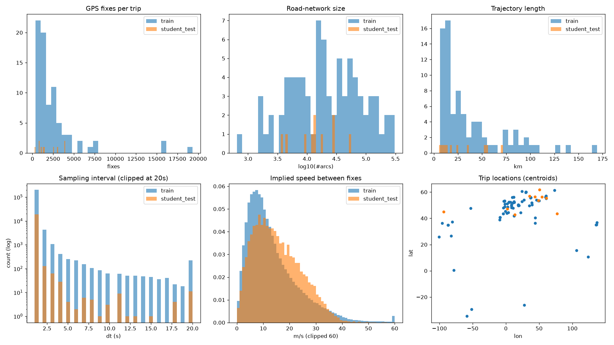
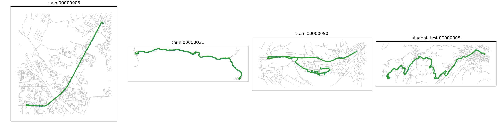
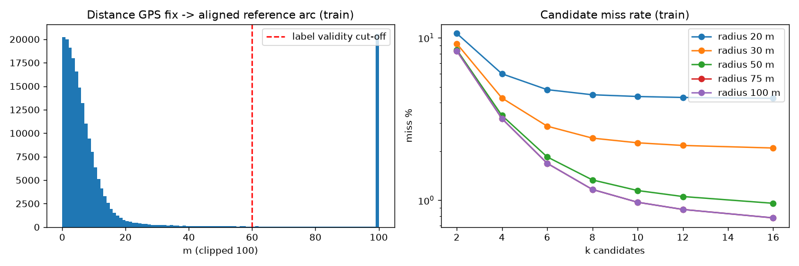

## 2.2 Dataset understanding and exploratory data analysis
*Partitions used: TRAIN (80 trips) and STUDENT-TEST (10 trips). Evaluator trips were not opened during development.*
Script: `scripts/eda.py`. Outputs: `results/eda/` (`inventory.csv` has one row per trip, `summary_by_partition.csv` the partition totals).

### Raw data structure (checked in the files, not assumed)
| File | Format (checked) | Notes |
|---|---|---|
| `.track` | lon, lat, t (s), whitespace-separated, no header | 262–19,313 fixes per trip. Every trip has all four files |
| `.nodes` | lon, lat. Row index = node id | 299–155,003 nodes per trip. 0 isolated nodes |
| `.arcs` | from_node, to_node. Row index = arc id | **Directed**: a two-way street is two arcs, so #arcs ≈ 2 × #nodes (649–307,392) |
| `.route` | ordered arc ids | **Arc-level, not fix-level**: 59–2,266 arcs against 262–19,313 fixes. Consecutive route arcs connect (to-node = next from-node) in at least 98.1% of steps. 10 trips revisit an arc |

### Missing-value and data-quality analysis
| Check | Train (80 trips) | Student test (10 trips) |
|---|---|---|
| GPS fixes | 208,417 | 19,160 |
| NaN / non-finite coordinates | 0 | 0 |
| Non-monotonic timestamps | 0 | 0 |
| Steps of exactly 1 s | 93.8% | 98.2% |
| Time gaps > 10 s (missing fixes) | 590 | 27 |
| Largest time gap | 153,064 s (42.5 h) | 210 s |
| Position jumps > 70 m/s | 147 | 1 |
| Isolated road nodes | 0 | 0 |
| Weakly connected components (median) | 20 | 11 |
| Largest strongly connected component (min share of nodes) | 63.6% | 81.7% |
| Reference route continuity (min) | 98.1% | 99.7% |
| Trips that revisit a route arc | 9 | 1 |

There are no missing values in the files. The "missing data" in this dataset is missing *time*: gaps in the track. The two largest gaps (42 h in trip 90, 14.7 h in trip 78) are really separate drives stored in one file. The second kind of missing information is a missing link between a fix and the road it was on, which we handle in the labelling step below.

### Observations
- **Global spread.** Trip centroids range from −100° to 137° longitude, so the trips come from many cities on several continents (`eda_overview.png`, bottom right). We therefore use **no absolute-coordinate features**: the evaluator trips may come from places we never trained on.
- **Sampling.** Most steps are 1 s, but the tail is long (bottom left, log scale).
- **Speeds.** Implied speeds are mostly 0–35 m/s, a normal urban and rural driving profile. The student-test trips are slightly faster than the train trips (bottom middle).
- **Road networks.** The median trip has 19 weakly connected components, and the largest strongly connected component covers 64–100% of nodes. Each network covers only the area around its trip, so roads that leave that area can end abruptly. A shortest path between two candidate arcs can therefore be missing, and the HMM must survive that (Section 5).
- **Reference-route quality.** After alignment, the median distance from a fix to its reference arc is 5.7 m on train and 5.3 m on student test (`labels_and_candidates.png`). Two training trips (33 and 54) have reference routes offset 120–140 m from the GPS (median 122 m and 140 m). We treat those fixes as unlabelled and do not try to "correct" them. These two trips account for 90% of the 22,343 unlabelled training fixes; only 25 student-test fixes are unlabelled. The reference route is treated as reference information, not as error-free ground truth.

### Preprocessing (`src/pathsnap/track.py`, `geo.py`)
1. Drop non-finite and out-of-range coordinates, sort by time, and drop duplicate timestamps. None were present, but the checks stay for unseen trips.
2. **Projection.** Each trip is projected to its own UTM zone with `pyproj`. Euclidean distance in degrees is wrong because a degree of longitude shrinks with latitude. Within one city, UTM distortion is below 0.1%, far below GPS noise.
3. **Segmentation.** A new segment starts when dt > 120 s or the implied speed is > 70 m/s. The HMM restarts at each segment.
4. **Kinematics.** Heading and speed are computed from fixes i−2 … i+2 inside the same segment. Single-step differences are too noisy at 1 Hz.

### Turning the arc-level route into per-fix labels (`labels.py`)
Fixes are not linked to arcs in the raw data. We solve a **monotone alignment** with dynamic programming: each fix i gets a route position jᵢ, with j non-decreasing, minimising Σ dist(fixᵢ, route_arc_jᵢ). Monotonicity respects the driving order and handles routes that revisit an arc. Fixes more than 60 m from their aligned arc are marked *unlabelled*: they are left out of training and scoring, but they are still predicted.

### Candidate generation (`network.py`)
Arcs are densified every 10 m into a KD-tree. For each fix we keep the k nearest arcs (by exact perpendicular distance) within radius R. If nothing is within R, the search widens to 300 m. R and k were chosen on **train only** from the miss-rate grid (`candidate_miss_grid_train.csv`): the smallest candidate set within 0.2 percentage points of the best miss rate. That gave **R = 75 m and k = 10**, with a candidate miss rate of 0.97% on train and 0.13% on student test.

### Features (`features.py`), one row per (fix, candidate arc)
| Feature group | Features | Why we chose them |
|---|---|---|
| Distance | `dist`, `dist_rank`, `dist_minus_min`, `dist_ratio`, `n_cand` | Closeness is the main signal. *Relative* closeness matters most in dense areas with parallel streets |
| Direction | `ang_diff`, `cos_diff`, `along_speed`, `cross_speed`, `speed` | Arcs are directed: the reverse twin of the right street has the same geometry and differs only in direction |
| Arc geometry and topology | `arc_len`, `proj_t`, `d_endpoint`, `out_deg_end`, `in_deg_start`, `is_twoway` | Junction ambiguity: near a node, several arcs are equally close |
| Temporal context | `ctx_dist_mean`, `ctx_excess_mean`, `ctx_ang_mean` (±5 fixes) | One noisy fix can be closer to a side street. The right arc also explains the *neighbouring* fixes |
| Sampling | `dt_prev` | Gaps make a fix less reliable |

13.2% of candidate rows are positive. The training table has 1.40M rows (186,074 labelled fixes). The feature importances of the final model (Section 3.3) confirm the choices: relative distance (`dist_minus_min`) and context heading agreement (`ctx_ang_mean`) carry half of the total gain.

**Folium maps.** `results/eda/map_*.html` show the GPS fixes, the nearby road network and the reference route, with a legend and a layer control. Screenshots are in Section 6.
