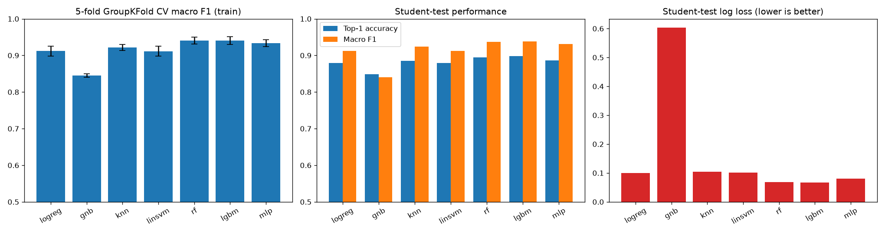
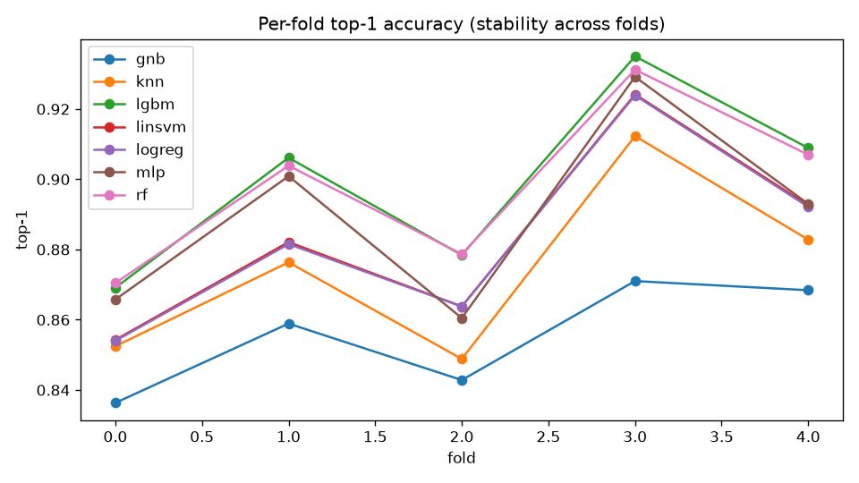
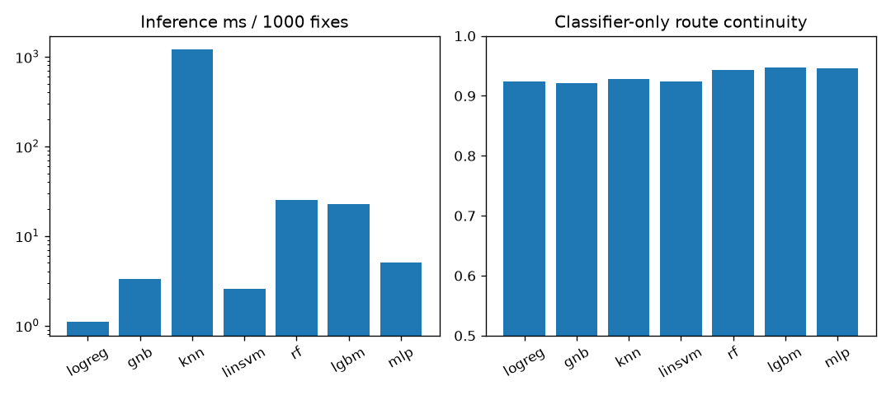
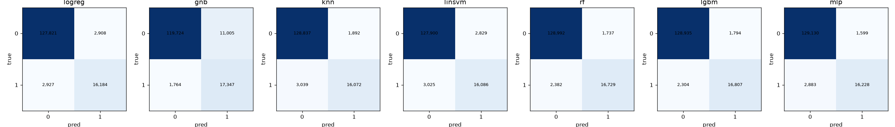
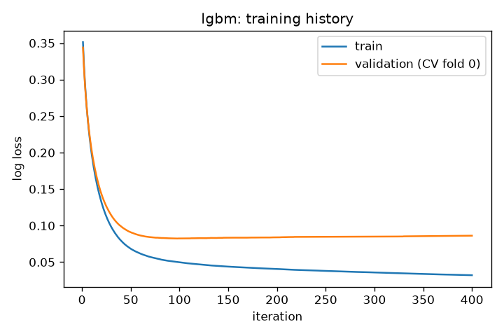
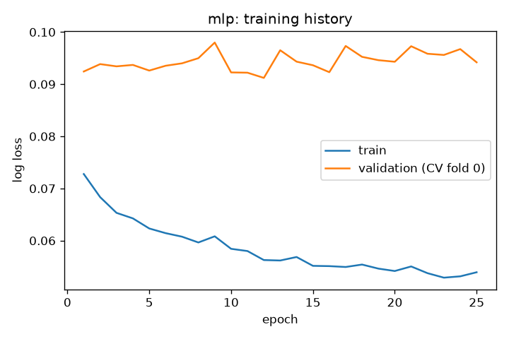

## 3. Model experimentation and comparison
*Partitions: TRAIN (80 trips) for fitting and cross-validation, STUDENT-TEST (10 trips) for comparison. Evaluator trips were not used.*
Script: `scripts/train_models.py`. Outputs: `results/models/` and `results/models_train_log.txt`.

**Task framing.** Arc ids are local to each trip, so a multi-class model over arcs cannot generalise to a new road network. We score every (fix, candidate arc) pair as a binary problem: "is this the fix's reference arc?". The predicted arc for a fix is the candidate with the highest score. 13.2% of candidate rows are positive.

**Protocol (same for all 7 models).**
- **Validation.** 5-fold `GroupKFold` grouped by trip on the 80 training trips. Then a refit on the training trips and one evaluation on the 10 student-test trips (149,840 candidate rows, 19,160 fixes).
- **Training samples.** Samples are drawn by fix, so each fix keeps its whole candidate set.
  - Most models: 80,000 fixes (601,137 rows) per training set.
  - KNN: 20,000 fixes (150,770 rows), because prediction cost grows with the training set.
  - Linear SVM: 40,000 fixes (300,856 rows), because the calibration step fits three SVMs.
- **Train-set score (overfitting check).** Macro F1 and log loss on a separate 20,000-fix sample of the training trips (seed 1). For models fitted on 80,000 fixes, part of this sample was seen during fitting, so the train–CV gap is a lower bound on the true in-sample gap.
- **Metrics.**
  - Macro F1 and log loss on candidate rows (threshold 0.5).
  - Observation-level top-1 accuracy.
  - Candidate miss rate (0.13% on student test, the same for every model because candidates are generated before the classifier).
  - Classifier-only route continuity: the share of consecutive fixes whose top-1 arcs are equal or directly connected.
  - Length-weighted route F1.
  - Fit time and inference time per 1,000 fixes.
- Random seed 42 everywhere.

**Primary selection metric: observation-level top-1 accuracy.** It is exactly what is scored per GPS fix, and it is what the decoder consumes. Macro F1 depends on a 0.5 threshold that we never use for routing. Log loss is the secondary metric because the HMM uses the probabilities themselves as emissions, so probability quality matters.

### 3.1 Overall comparison

| Model | Algorithm family | Key configuration | CV macro F1 (± std) | CV top-1 | Student-test top-1 | Route continuity (clf-only, test) | Student-test macro F1 | Student-test log loss | Inference ms / 1000 fixes |
|---|---|---|---|---|---|---|---|---|---|
| Logistic Regression | Linear | StandardScaler + L2, C=1, lbfgs | 0.9117 ± 0.0132 | 0.8831 | 0.8792 | 0.9240 | 0.9125 | 0.1001 | 1.1 |
| Gaussian NB | Probabilistic | var_smoothing=1e-9 | 0.8450 ± 0.0044 | 0.8555 | 0.8487 | 0.9206 | 0.8402 | 0.6036 | 3.3 |
| KNN | Instance-based | k=50, distance-weighted, scaled | 0.9218 ± 0.0086 | 0.8745 | 0.8848 | 0.9279 | 0.9241 | 0.1041 | 1201.6 |
| Linear SVM | Kernel (linear) | LinearSVC C=1 + sigmoid calibration | 0.9116 ± 0.0135 | 0.8834 | 0.8793 | 0.9235 | 0.9118 | 0.1007 | 2.6 |
| Random Forest | Ensemble (bagging) | 200 trees, depth 20, min_leaf 5 | 0.9410 ± 0.0094 | 0.8982 | 0.8944 | 0.9426 | 0.9373 | 0.0678 | 24.9 |
| **LightGBM** | Boosting | 400 trees, lr 0.05, 63 leaves | **0.9410 ± 0.0106** | **0.8995** | **0.8981** | **0.9473** | **0.9378** | **0.0673** | 22.6 |
| MLP | Neural network | (64,32) ReLU, Adam 1e-3, α=1e-4, 25 epochs | 0.9339 ± 0.0093 | 0.8899 | 0.8866 | 0.9459 | 0.9308 | 0.0808 | 5.0 |

Precision and recall for the positive class (student test, threshold 0.5), fit time on the full training sample, and the train-set scores:

| Model | Precision | Recall | Train macro F1 | Train log loss | CV log loss | Fit time (s) |
|---|---|---|---|---|---|---|
| Logistic Regression | 0.848 | 0.847 | 0.9146 | 0.1044 | 0.1078 | 1.3 |
| Gaussian NB | 0.612 | 0.908 | 0.8483 | 0.5597 | 0.5950 | 0.2 |
| KNN | 0.895 | 0.841 | 0.9403 | 0.0801 | 0.1174 | 0.1 |
| Linear SVM | 0.850 | 0.842 | 0.9138 | 0.1048 | 0.1076 | 5.2 |
| Random Forest | 0.906 | 0.875 | 0.9626 | 0.0488 | 0.0682 | 58.0 |
| LightGBM | 0.904 | 0.879 | 0.9668 | 0.0412 | 0.0705 | 6.5 |
| MLP | 0.910 | 0.849 | 0.9504 | 0.0592 | 0.0833 | 90.0 |

**Selection: LightGBM.**
- It has the highest CV top-1 (0.8995), the highest student-test top-1 (0.8981), the lowest student-test log loss (0.0673) and the highest classifier-only route continuity (0.9473).
- Random Forest is tied on CV macro F1 (0.9410 for both) and close on top-1. LightGBM fits about 9× faster (6.5 s vs 58 s) and its model file is about 2.8 MB, while the Random Forest was too large to commit. That matters for loading on the API laptop and for the repository size limit.
- Fold-to-fold variation (top-1 std ≈ 0.022–0.025) is mostly *between trips* and is shared by all models. Every model scores highest on fold 3 and lowest on fold 0 or fold 2 (`cv_folds.csv`). LightGBM and Random Forest split the folds: LightGBM is higher on folds 1, 3 and 4, Random Forest on folds 0 and 2 (by 0.0014 and 0.0003).
- The probabilities go straight into the HMM, so the lowest log loss is the deciding point between the two tree ensembles.

### 3.2 Per-model analysis

#### 3.2.1 Logistic Regression

**A. Model understanding**

1. *Why suitable.* It is the simplest model that outputs a probability for each candidate, and the HMM needs probabilities. Several of our features are already relative to the other candidates (`dist_minus_min`, `dist_rank`, `dist_ratio`), so we wanted to know whether a linear score on them is already enough.
2. *Strengths and limitations.* It is the fastest model at inference (1.1 ms per 1,000 fixes), it is stable across folds, and its coefficients can be read. It has one linear boundary, so it cannot model interactions. For example, heading agreement is only informative when the vehicle is moving: at low speed the GPS heading is noise. A linear model gives heading the same weight at 2 m/s and at 20 m/s.

**B. Training and configuration**

5. *Hyperparameters.* StandardScaler, then `LogisticRegression(C=1.0, penalty="l2", solver="lbfgs", max_iter=1000)`. Trained on 80,000 fixes.
6. *Objective.* L2-regularised binary cross-entropy (log loss).

**C. Experimental results**

7. *Student-test performance.* Top-1 0.8792, route continuity 0.9240, route F1 0.9299. Errors at the 0.5 threshold are balanced: 2,908 false positives and 2,927 false negatives (`confusion_matrices.json`).
8. *Top-1 / macro F1 / log loss.* 0.8792 / 0.9125 / 0.1001.
9. *Fit.* Underfitting. Train macro F1 0.9146, CV 0.9117 and test 0.9125 are all the same, and train log loss 0.1044 is close to CV 0.1078. There is no variance problem. The model is about 3 points of CV macro F1 below the tree models and its log loss is about 50% higher, which is bias from the linear boundary.

#### 3.2.2 Gaussian Naive Bayes

**A. Model understanding**

1. *Why suitable.* It is the cheapest probabilistic baseline. It shows how far the features separate the two classes when each feature is treated on its own.
2. *Strengths and limitations.* It trains in 0.2 s and has nothing to tune. It assumes the features are independent and Gaussian within each class. Neither holds here. `dist`, `dist_minus_min`, `dist_ratio` and `ctx_dist_mean` all measure closeness, so the same evidence is counted several times. Distances are skewed and bounded at zero, and angles are not Gaussian.

**B. Training and configuration**

5. *Hyperparameters.* `GaussianNB(var_smoothing=1e-9)` (default). Class priors from the data (13.2% positive). Trained on 80,000 fixes.
6. *Objective.* Maximum-likelihood estimates of the per-class mean and variance of each feature. Prediction is by Bayes' rule. There is no iterative loss.

**C. Experimental results**

7. *Student-test performance.* Top-1 0.8487, route continuity 0.9206, route F1 0.9053. The double counting makes it over-confident: 11,005 false positives against 1,794 for LightGBM, so precision is only 0.612 while recall is 0.908.
8. *Top-1 / macro F1 / log loss.* 0.8487 / 0.8402 / 0.6036.
9. *Fit.* Underfitting (model bias). Train 0.8483, CV 0.8450 and test 0.8402 macro F1 are equal, and the fold std is the smallest of all models (0.0044). Log loss is 0.51–0.85 on the five folds, about 9× worse than LightGBM. Top-1 suffers less than log loss: the ranking of candidates within one fix partly survives the bad calibration.

#### 3.2.3 K-Nearest Neighbours

**A. Model understanding**

1. *Why suitable.* A candidate whose features look like those of known correct candidates is probably correct. KNN makes no assumption about the shape of the boundary, and all features are relative and scaled, so distance in feature space is meaningful.
2. *Strengths and limitations.* It is non-parametric and captures non-linear patterns with no training step. Prediction is the problem. It compares every candidate with the training rows, so we had to cut the training set to 20,000 fixes, and inference still takes 1,201.6 ms per 1,000 fixes, about 50× slower than LightGBM. For the largest student-test trip (3,958 fixes) that is almost 5 s of classification alone. After scaling, all features weigh the same, so weak features such as `dt_prev` add noise to the distance.

**B. Training and configuration**

5. *Hyperparameters.* StandardScaler, then `KNeighborsClassifier(n_neighbors=50, weights="distance", metric="euclidean")`. Trained on 20,000 fixes (150,770 rows).
6. *Objective.* None (lazy learner). The probability is the distance-weighted vote of the 50 nearest training rows.

**C. Experimental results**

7. *Student-test performance.* Top-1 0.8848, route continuity 0.9279, route F1 0.9356. It is conservative at 0.5 (precision 0.895, recall 0.841).
8. *Top-1 / macro F1 / log loss.* 0.8848 / 0.9241 / 0.1041.
9. *Fit.* Mild overfitting. Train macro F1 0.9403 against CV 0.9218, and train log loss 0.0801 against CV 0.1174. Its CV top-1 (0.8745) is below the two linear models but its student-test top-1 (0.8848) is above them. With only 20,000 training fixes the result depends more on which trips it sees.

#### 3.2.4 Linear SVM

**A. Model understanding**

1. *Why suitable.* It is a maximum-margin linear classifier. Comparing it with Logistic Regression tells us whether the loss function or the linear boundary is what limits accuracy.
2. *Strengths and limitations.* It is fast at inference (2.6 ms per 1,000 fixes) and ignores points far from the margin. It does not output probabilities, so we needed Platt (sigmoid) calibration with 3-fold internal CV. That triples the fitting cost, so we trained it on 40,000 fixes. It has the same linear limitation as Logistic Regression.

**B. Training and configuration**

5. *Hyperparameters.* StandardScaler, then `CalibratedClassifierCV(LinearSVC(C=1.0), method="sigmoid", cv=3)`. Trained on 40,000 fixes (300,856 rows).
6. *Objective.* L2-regularised squared hinge loss (the `LinearSVC` default). The calibration step then fits a sigmoid on the SVM scores by minimising log loss.

**C. Experimental results**

7. *Student-test performance.* Top-1 0.8793, route continuity 0.9235, route F1 0.9313.
8. *Top-1 / macro F1 / log loss.* 0.8793 / 0.9118 / 0.1007.
9. *Fit.* Underfitting, exactly like Logistic Regression. Train 0.9138, CV 0.9116 and test 0.9118 macro F1 are equal. Its top-1 (0.8793) is the same as Logistic Regression's (0.8792) to three decimals, and so are its fold scores. Changing the loss from cross-entropy to hinge made no difference, so the limit is the linear boundary.

#### 3.2.5 Random Forest

**A. Model understanding**

1. *Why suitable.* Trees split on thresholds, so they handle features on different scales without scaling, and they capture interactions such as "heading matters only above some speed" or "distance matters relative to how dense the network is". Averaging many trees gives smooth probabilities.
2. *Strengths and limitations.* It works well out of the box and is robust to noisy features. The model is large: 200 trees of depth up to 20 make a file far bigger than LightGBM's (we did not commit it), it is the second-slowest model to fit (58 s), and deep trees can memorise the training rows.

**B. Training and configuration**

5. *Hyperparameters.* `RandomForestClassifier(n_estimators=200, max_depth=20, min_samples_leaf=5, max_features="sqrt", random_state=42)`. Trained on 80,000 fixes.
6. *Objective.* Each tree greedily minimises Gini impurity at each split, on a bootstrap sample with random feature subsets. The probability is the average of the leaf class fractions.

**C. Experimental results**

7. *Student-test performance.* Top-1 0.8944, route continuity 0.9426, route F1 0.9459. Second best overall.
8. *Top-1 / macro F1 / log loss.* 0.8944 / 0.9373 / 0.0678.
9. *Fit.* Moderate overfitting that does not hurt generalisation much. Train macro F1 0.9626 against CV 0.9410, and train log loss 0.0488 against CV 0.0682. CV and test agree (0.9410 and 0.9373), so the depth limit of 20 and minimum leaf size of 5 keep the overfitting under control.

#### 3.2.6 LightGBM (selected)

**A. Model understanding**

1. *Why suitable.* Gradient-boosted trees capture the same interactions as the Random Forest, but each new tree corrects the errors of the previous ones. It optimises log loss directly, which is what the HMM needs. Its histogram-based training is fast on 600k+ rows.
2. *Strengths and limitations.* It has the best accuracy and log loss, fits in 6.5 s, and gives a small model file. It has more hyperparameters than a Random Forest, and too many trees or leaves overfit. The training history below shows exactly that.

**B. Training and configuration**

5. *Hyperparameters.* `LGBMClassifier(n_estimators=400, learning_rate=0.05, num_leaves=63, random_state=42)`. Everything else at LightGBM defaults (`min_child_samples=20`, no row or column subsampling, no L1/L2 regularisation). Trained on 80,000 fixes.
6. *Objective.* Binary log loss (cross-entropy), minimised by gradient boosting with leaf-wise tree growth.

**C. Experimental results**

7. *Student-test performance.* Top-1 0.8981, route continuity 0.9473, route F1 0.9507. Best on every accuracy and probability metric.
8. *Top-1 / macro F1 / log loss.* 0.8981 / 0.9378 / 0.0673.
9. *Fit.* Slight overfitting. Train macro F1 0.9668 against CV 0.9410, and train log loss 0.0412 against CV 0.0705. The fold-0 history (`history_lgbm.png`) shows it directly: validation log loss is lowest at iteration 98 (0.0824) and creeps up to 0.0862 by iteration 400, while training log loss keeps falling to 0.0321. The 400-tree, 63-leaf configuration goes past the best point. This motivated the Bayesian tuning in Section 4, which chose much smaller trees (25 leaves) and larger leaves (`min_child_samples=157`).

#### 3.2.7 Multi-layer Perceptron

**A. Model understanding**

1. *Why suitable.* A neural network learns non-linear combinations of the features. It is a different family from the trees, and it gives a smooth probability.
2. *Strengths and limitations.* Inference is fast (5.0 ms per 1,000 fixes) and the model is small. It needs scaled inputs and is sensitive to the learning rate and regularisation. It was the slowest model to train (90 s for 25 epochs on CPU), and on tabular features like ours it did not reach the tree models.

**B. Training and configuration**

5. *Hyperparameters.* StandardScaler, then `MLPClassifier(hidden_layer_sizes=(64, 32), activation="relu", solver="adam", learning_rate_init=1e-3, alpha=1e-4)`. Trained for 25 epochs with `partial_fit` on mini-batches of 20,000 rows, so the loss could be recorded every epoch. Trained on 80,000 fixes.
6. *Objective.* Binary cross-entropy plus an L2 penalty (α), minimised with Adam.

**C. Experimental results**

7. *Student-test performance.* Top-1 0.8866, route continuity 0.9459, route F1 0.9459. It has the highest precision of all models (0.910) but lower recall (0.849).
8. *Top-1 / macro F1 / log loss.* 0.8866 / 0.9308 / 0.0808.
9. *Fit.* Overfitting from early on. In the fold-0 history (`history_mlp.png`), training log loss falls from 0.0728 to 0.0539 over 25 epochs, while validation log loss is flat: best 0.0912 at epoch 12 and 0.0942 at epoch 25. Train macro F1 0.9504 against CV 0.9339. Early stopping around epoch 12 or a larger α would help. We did not tune it further because the tree models were already better.

### 3.3 Model visualisations
All plots are generated by `scripts/train_models.py` from the runs above.

Training and validation loss curves exist only for the two models that train iteratively. The other five have no epoch-wise history, so none is drawn.

