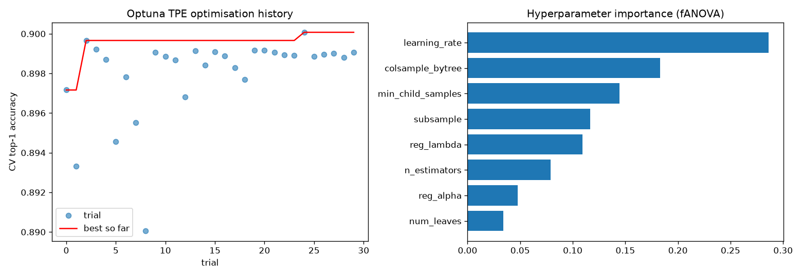
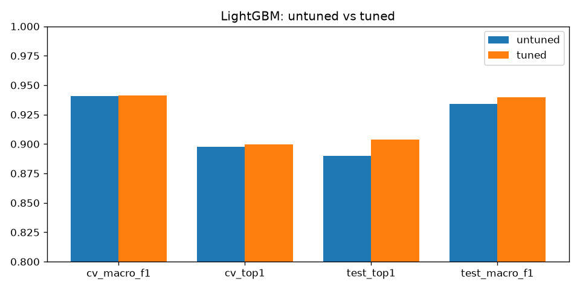

## 4. Bayesian hyperparameter optimisation (LightGBM)
*Partitions: TRAIN for the search and cross-validation, STUDENT-TEST for the tuned vs untuned comparison. Evaluator trips were not used.*
Script: `scripts/tune_optuna.py`. Outputs: `results/optuna/` (`optuna_trials.csv` is the full trial record, `best_params.json`, `tuned_vs_untuned.csv`) and `results/optuna_log.txt`.

1. **Hyperparameters in the search, and their ranges.**

   | Hyperparameter | Range / distribution | Why |
   |---|---|---|
   | `n_estimators` | 100–600, step 50 | Number of trees (capacity) |
   | `learning_rate` | 0.01–0.2, log-uniform | Step size; trades off against the number of trees |
   | `num_leaves` | 15–255, log-uniform | Tree complexity |
   | `min_child_samples` | 5–200, log-uniform | Minimum rows per leaf (regulariser) |
   | `subsample` | 0.5–1.0 (with `subsample_freq=1`) | Row bagging (regulariser) |
   | `colsample_bytree` | 0.4–1.0 | Feature bagging (regulariser) |
   | `reg_lambda` | 1e-3–10, log-uniform | L2 penalty on leaf values |
   | `reg_alpha` | 1e-3–10, log-uniform | L1 penalty on leaf values |

   Section 3 showed that the untuned model overfits slightly (validation log loss bottoms out at iteration 98 of 400), so half of the space is regularisation.

2. **Search strategy.** Optuna's Tree-structured Parzen Estimator (TPE) sampler, seed 42. The untuned configuration was enqueued as trial 0, so the search starts from the baseline.
3. **Objective.** Mean observation-level top-1 accuracy over 3-fold `GroupKFold` (grouped by trip) on a 40,000-fix sample of the TRAIN trips. This is the same metric we used to choose the model.
4. **Trials.** 30 trials in 284 s (about 9.5 s per trial).
5. **Best values** (best search score 0.9001):
   `n_estimators=450`, `learning_rate=0.0441`, `num_leaves=25`, `min_child_samples=157`, `subsample=0.766`, `colsample_bytree=0.592`, `reg_lambda=0.0017`, `reg_alpha=0.0015`.
   The search preferred much smaller trees (25 leaves instead of 63) with much larger leaves (157 rows instead of 20), plus row and column subsampling. That is a more regularised model, which fits the overfitting we saw. The L1/L2 penalties ended near the bottom of their ranges, so the regularisation came from tree shape and subsampling, not from the penalties.
6. **Tuned vs untuned.** Both were refit on all 186,074 labelled training fixes and evaluated with the same 5-fold CV and the same student-test set.

| | CV macro F1 | CV top-1 | Student-test top-1 | Student-test macro F1 | Student-test log loss | Fit time (s) | Inference ms / 1000 fixes |
|---|---|---|---|---|---|---|---|
| Untuned | 0.9408 | 0.8974 | 0.8901 | 0.9338 | 0.0773 | 14.2 | 24.3 |
| Tuned | 0.9413 | 0.8997 | **0.9037** | **0.9395** | **0.0665** | 13.6 | 19.8 |

The tuned model is better on every metric: +1.4 points of student-test top-1, −14% student-test log loss, and slightly faster at both fitting and inference (fewer leaves per tree). The CV gain is small (+0.2 points of top-1), so the improvement is real but modest, and part of the student-test gain reflects which 10 trips happen to be in that partition. The tuned model is the one deployed (`artifacts/classifier_lgbm_tuned.joblib`).

**Why the untuned numbers differ from Section 3.1.** In Section 3 every model was fitted on the same 80,000-fix sample, and untuned LightGBM scored 0.8981 student-test top-1. Here the untuned model is refit on all 186,074 fixes and scores 0.8901. The hyperparameters are identical; only the training rows differ. So the training sample alone moves student-test top-1 by about 0.8 points, with the untuned 400-tree model doing worse on more data. This is why the tuned and untuned models are compared under exactly the same protocol, and why we read small differences between models with care.

