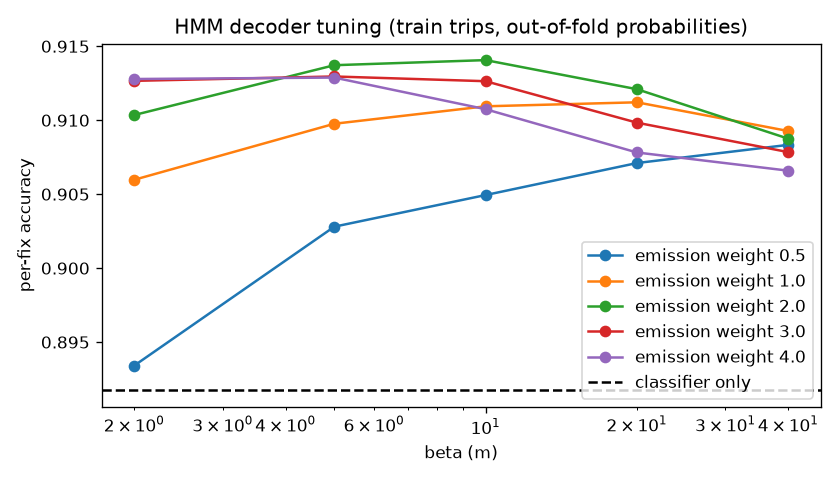
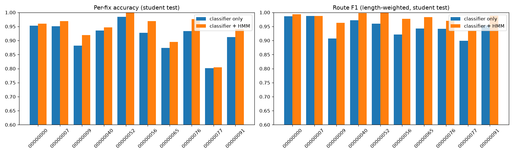
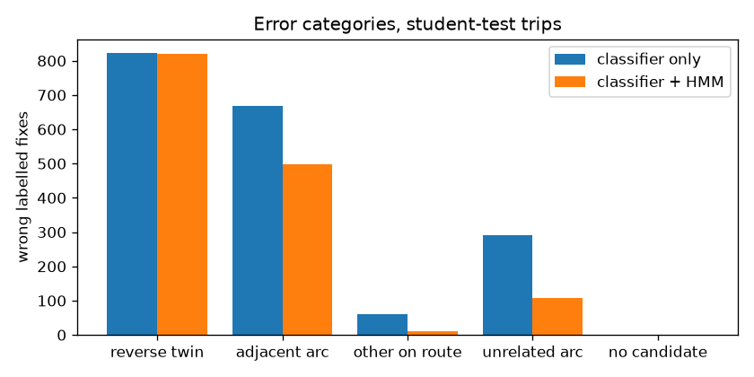
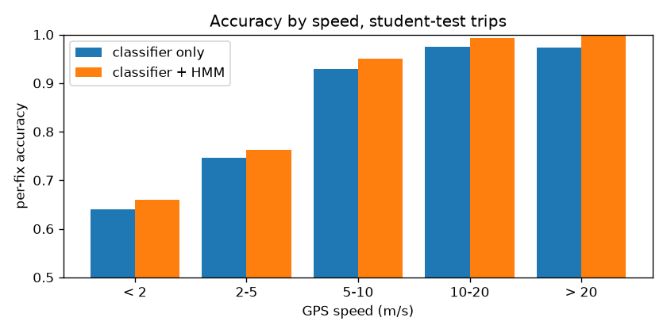

## 5. HMM and Viterbi route reconstruction
*Partitions: decoder parameters tuned on TRAIN only (out-of-fold probabilities); comparison and error analysis on STUDENT-TEST. Evaluator trips were not used.*
Code: `src/pathsnap/hmm.py`. Tuning and evaluation: `scripts/tune_eval_hmm.py` → `results/hmm/`, `results/hmm_log.txt`. Error analysis: `scripts/hmm_error_analysis.py` → `results/hmm_analysis/`.

1. **Hidden states.**
   - At fix *i*, the states are its candidate arcs: the top 8 by classifier probability, out of the k = 10 generated.
   - Each state also keeps the fix's projected position along that arc. A state *is* an arc id, so the candidate-to-road-segment correspondence is never lost.
2. **Emission probabilities.**
   - log P(zᵢ | s) = w · log( p̂(s) / Σₛ′ p̂(s′) ).
   - p̂ is the tuned LightGBM probability, normalised over the fix's candidate set.
   - w is the emission weight. It sets how much the decoder trusts the classifier against road continuity.
3. **Transition probabilities** (in the style of Newson and Krumm).
   - log P(s′ | s) = −|d_route(s→s′) − d_gps(i−1→i)| / β.
   - d_route is the directed network distance: the rest of arc s, plus the shortest path from the end node of s to the start node of s′ (bounded Dijkstra, cached per node), plus the position on s′.
   - On the same arc, forward movement is just the difference in position. Moving backwards by more than 10 m has to loop through the network.
   - Wrong-way travel and jumps to parallel streets therefore get long route distances and low probability.
4. **Missing candidates and large GPS gaps.**
   - Fixes with no arc within 75 m use a 300 m fallback search. If there is still nothing, the fix is skipped (arc = −1) and the chain links its neighbours directly.
   - At gaps over 120 s or jumps over 70 m/s, the chain is cut and Viterbi restarts from the emissions alone.
   - The Dijkstra search limit grows with the GPS distance and the time step: min(5 km, 2·d_gps + 200 m + 20 m per extra second).
5. **Consecutive fixes on disconnected road segments.**
   - An unreachable transition gets a constant log-penalty of −40 instead of −∞. One bad fix or a missing network link therefore cannot make the whole sequence impossible.
   - When the decoded arcs are stitched into a route, the shortest path is inserted between consecutive distinct arcs. If no path exists within 5 km, or the two fixes are in different track segments, a *route break* is recorded and reported. There were 3 breaks across all 10 student-test trips.
6. **Viterbi recurrence.**
   - δᵢ(s′) = max_s [δᵢ₋₁(s) + log P(s′|s)] + log P(zᵢ|s′), with back-pointers, then backtracking from argmax δ_N.
   - Everything is in log space. The cost is O(N·M²) per trip with M ≤ 8 states.

**Decoder tuning (train only).**
- Grid β ∈ {2, 5, 10, 20, 40} m × w ∈ {0.5, 1, 2, 3, 4} on 25 training trips, using **out-of-fold** probabilities from the 5-fold CV of the tuned model. The decoder therefore sees probabilities as noisy as on unseen trips.
- Best: **β = 10 m, w = 2**, an interior optimum, with per-fix accuracy 0.9141 against 0.8917 for classifier-only on the same trips (`hmm_grid_train_oof.csv`). Both extremes lose: w = 0.5 (too little trust in the classifier) is the worst setting for β ≤ 20, and accuracy also falls at large β with large w, where the road-continuity term carries little weight. Every setting beats classifier-only.

### 5.1 Classifier-only vs classifier + HMM (student test, 19,160 fixes)

| | Per-fix accuracy | Fix-to-fix continuity | Route F1 (length-weighted) | Route precision | Route recall |
|---|---|---|---|---|---|
| Classifier only (top-1) | 0.9038 | 0.9458 | 0.9471 | 0.9180 | 0.9793 |
| Classifier + HMM/Viterbi | **0.9247** | **0.9771** | **0.9795** | **0.9632** | **0.9970** |

Per-trip results: `student_test_clf_vs_hmm.csv`. (Section 4 reports 0.9037 for the same classifier; the two scripts' counts differ by about one fix.)

- **Improvements.** The HMM improved per-fix accuracy on all 10 trips. The largest gains came where the classifier jumped between parallel or adjacent arcs: trip 76 went from 93.4% to 97.6%, trip 56 from 92.7% to 96.9%, and trip 9 from 88.2% to 91.9%. The zoomed map in Section 6 shows one such place on trip 76.
- **Where it did not help: trip 77**, which only went from 80.1% to 80.4%. The error analysis below explains why.
- **Fix-level continuity is not 100% even after the HMM** (0.977). At 1 Hz a car often passes a whole short arc between two fixes. The *stitched* route fills those arcs back in, and its continuity is 0.999 (only the 3 route breaks remain).

### 5.2 Error analysis
The deployed pipeline (tuned classifier, β = 10, w = 2, 8 states) was run on the 10 student-test trips, giving 19,135 labelled fixes. Every wrong labelled fix is put in exactly one category, tested in this order:

- **Reverse twin**: the predicted arc is the opposite-direction twin of the reference arc (same street, wrong direction).
- **Adjacent arc**: shares a node with the reference arc (the next or previous arc, or a side street at the same junction), and is not the twin.
- **Other on route**: another arc of the reference route that is not adjacent.
- **Unrelated arc**: an arc that is not on the reference route.
- **No candidate**: no predicted arc.

| Category | Classifier only | Share | Classifier + HMM | Share |
|---|---|---|---|---|
| Reverse twin | 822 | 44.6% | 821 | 57.0% |
| Adjacent arc | 667 | 36.2% | 498 | 34.6% |
| Other on route | 61 | 3.3% | 12 | 0.8% |
| Unrelated arc | 291 | 15.8% | 109 | 7.6% |
| No candidate | 0 | 0.0% | 0 | 0.0% |
| **All errors** | **1,841** (accuracy 0.9038) | 100% | **1,440** (accuracy 0.9247) | 100% |

**Accuracy by GPS speed** (speed from the ±2-fix window)

| Speed (m/s) | Labelled fixes | Classifier only | Classifier + HMM | HMM errors | of which reverse twin |
|---|---|---|---|---|---|
| < 2 | 1,699 | 0.6398 | 0.6604 | 577 | 385 (66.7%) |
| 2–5 | 2,668 | 0.7455 | 0.7620 | 635 | 389 (61.3%) |
| 5–10 | 3,630 | 0.9284 | 0.9499 | 182 | 45 (24.7%) |
| 10–20 | 6,243 | 0.9749 | 0.9928 | 45 | 2 (4.4%) |
| > 20 | 4,895 | 0.9728 | 0.9998 | 1 | 0 (0.0%) |

**Interpretation.**
- **The HMM removes the errors that road continuity can fix.** Errors fall from 1,841 to 1,440 (−401). Almost all of that comes from adjacent arcs (667 → 498), unrelated arcs (291 → 109) and other route arcs (61 → 12). A jump to a parallel street or a side road costs a long route distance, so Viterbi avoids it.
- **It does not remove reverse-twin errors: 822 → 821.** A twin arc has the same geometry as the correct arc. For a slow vehicle, the route distance and the GPS step are almost the same in both directions, so the transition term cannot prefer one. The emission is the classifier's probability, which relies on heading and along-track speed, and both are unreliable at low speed. Twin errors therefore grow from 44.6% of the classifier's errors to 57.0% of the remaining HMM errors.
- **It is a slow-speed problem.** Fixes under 5 m/s are 22.8% of the labelled fixes (4,367) but 84.2% of the HMM errors (1,212 of 1,440), and 774 of the 821 twin errors (94.3%) are in these two speed bins. Above 10 m/s the HMM is almost perfect (0.9928 and 0.9998).
- **One trip dominates.** Trip 77 has a median speed of 3.7 m/s, the slowest of the ten (the others are 8.6–22.8 m/s). It has 575 of the 821 twin errors, and trip 40 has another 108. Together they are 683 (83.2%). Apart from trip 77, only trip 65 (0.8945) is below 0.9 HMM accuracy.
- **Route-level scores suffer less.** A wrong-direction arc lies on the right street, so the stitched route still covers the correct road. Trip 77's route F1 rises from 0.899 to 0.936 while its per-fix accuracy stays at 0.804.
- **No fix was left without a candidate** on these trips, so the 75 m radius and 300 m fallback are not a source of error here.

**Possible improvement (not implemented).** Penalise direction reversals between consecutive fixes, or compute heading and along-track speed over a longer window when the vehicle is slow. The decoder parameters were chosen on training trips only. Tuning a new term on the student-test trips would leak them into model selection, so the deployed decoder is unchanged.
