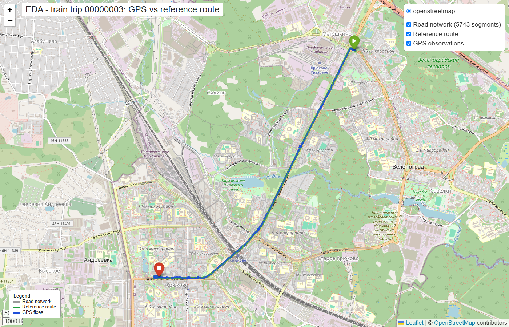
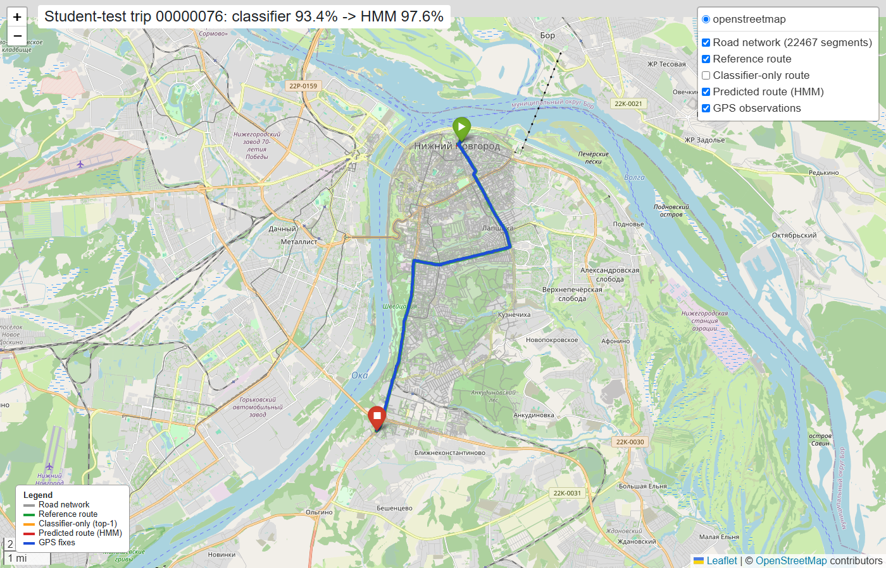
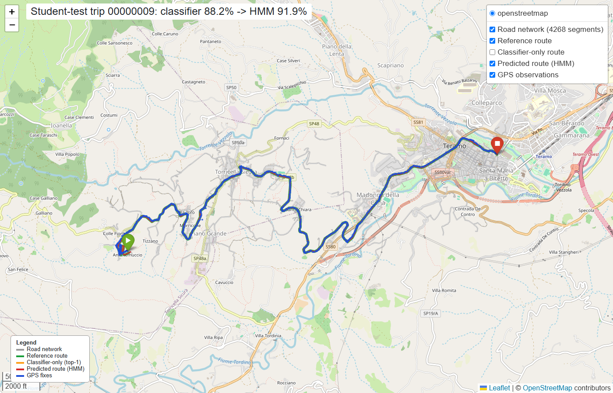

## 6. Geographical visualisation (Folium)
Map code: `src/pathsnap/visualize.py::trip_map`, called from `scripts/eda.py` (EDA maps) and `scripts/tune_eval_hmm.py` (prediction maps). The interactive HTML maps are committed in `results/eda/` and `results/hmm/`. The PNGs below are screenshots of those same HTML files, made by `scripts/export_map_figures.py` with headless Microsoft Edge.

Every map has:
- **Layers:** GPS fixes (blue dots with a time tooltip), the nearby road network (grey; two-way streets drawn once), the reference route (green, thick), the classifier-only top-1 route (orange, off by default) and the HMM predicted route (red).
- **Controls:** start and end markers, a title, a legend, a layer control to switch each layer on and off, and an initial zoom fitted to the trip.

| Map | Partition | Purpose |
|---|---|---|
| `results/eda/map_train_00000003.html`, `map_train_00000021.html`, `map_train_00000090.html` | Train | EDA: raw GPS vs road network vs reference route |
| `results/eda/map_student_test_00000009.html` | Student test | EDA |
| `results/hmm/map_student_test_00000009.html`, `00000056`, `00000076` | Student test | Prediction: classifier-only vs HMM vs reference |

