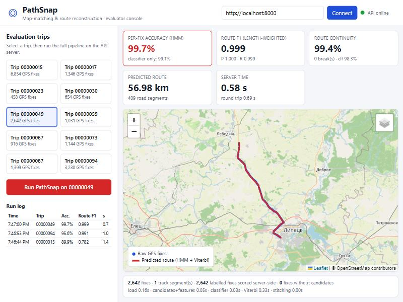

## 7. API, UI and deployment
Code: `api/main.py` (FastAPI), `ui/src/` (React + Vite + react-leaflet), `run_api.bat`, `run_ui.bat`. Setup steps are in the README.

**Laptop 1 (model + API)** runs `uvicorn api.main:app --host 0.0.0.0 --port 8000`.
- At start-up it loads `artifacts/classifier_lgbm_tuned.joblib` and `artifacts/config.json`, and checks that the feature list in the artifact matches the code.
- `GET /api/health` returns the model and decoder settings. `GET /api/trips` lists the trips in the evaluation folder.
- `POST /api/predict {"trip_id": ...}` runs the full pipeline: load → candidates → features → classifier → Viterbi → stitching.
- After prediction has finished, `pathsnap/evaluation.py` reads the trip's `.route` and returns only aggregate scores: per-fix accuracy for the HMM and for classifier-only, and route precision, recall and F1.
- Reference arcs and geometry are never sent to the UI. The prediction code (`inference.py`, `trip.py`) never reads the `.route` file.
- Every request is logged on the Laptop 1 console with the client IP, status, the steps and their timings, and the accuracy.

**Laptop 2 (UI)** serves the built React app (`npm run build`, then `npm run preview` or `run_ui.bat`).
- The user enters Laptop 1's address and clicks Connect. The UI lists the ten evaluation trips and sends the chosen id.
- It draws the GPS fixes and the predicted route on a Leaflet map, with score cards, a timing breakdown and a run log.

**Network.** At the evaluation, Laptop 2 joined Laptop 1's Windows mobile hotspot and reached the API at `http://192.168.137.1:8000`.

**Latency.** A full `/api/predict` request took 0.2–2.3 s on the student-test rehearsal trips (`results/api_demo_console.log`). The candidate search and Viterbi decoding take most of the time.

**About the screenshots.** We did not take screenshots during the two-laptop evaluation itself. The two below were taken afterwards on Laptop 1, with the same code, model and evaluator trip folder. Laptop 2 was not available, so for these screenshots the same UI build ran in a browser on Laptop 1 and connected to the API at `http://localhost:8000`. That is why the console shows `127.0.0.1` as the client; at the evaluation it showed Laptop 2's hotspot address. Three evaluator trips were run (00000015, 00000094, 00000049), and the scores in the UI's run log match the console line for line.

